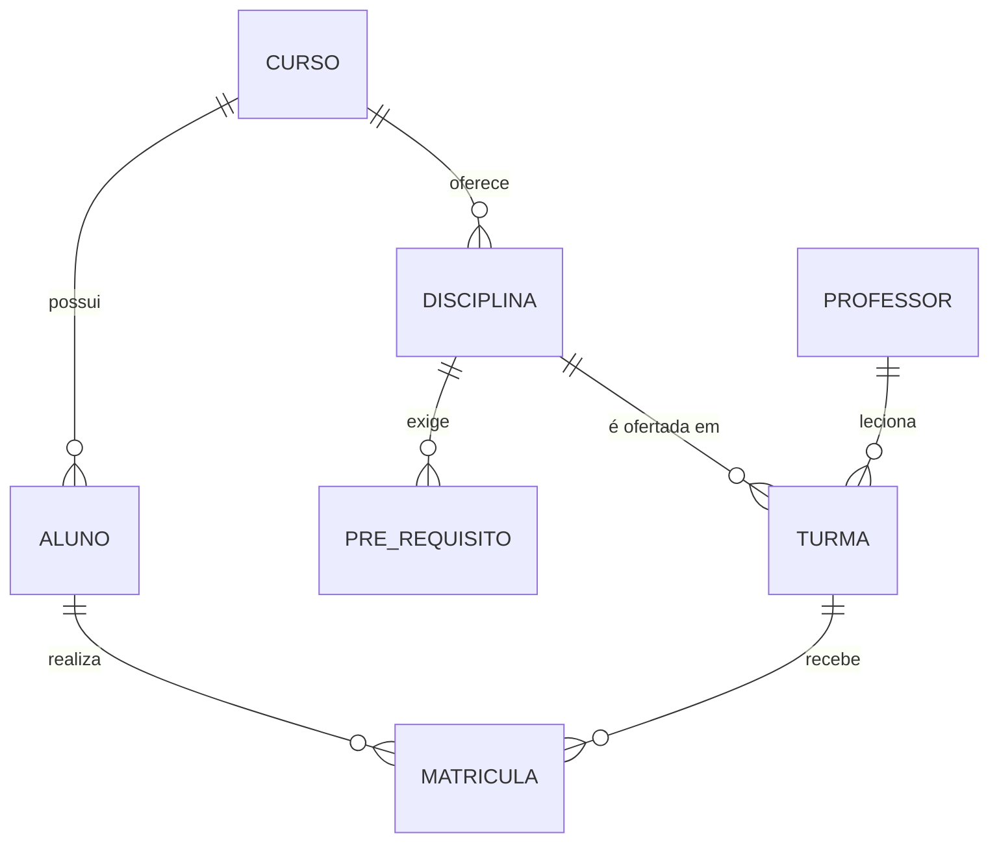

# Banco de Dados com PostgreSQL — Gestão Acadêmica

Sistema de **gestão acadêmica** (cursos, disciplinas, turmas, matrículas e notas) construído no **PostgreSQL 16** para explorar os recursos que diferenciam esse SGBD: schemas, domínios, tipos `ENUM`, `JSONB`, PL/pgSQL, CTE recursiva e views materializadas.

> Material das disciplinas de Banco de Dados — Prof. Eduardo Furlanetti.

## Estudo de caso



Regras de negócio implementadas no banco:

- **Situação automática**: ao lançar as duas notas e a frequência, uma *trigger* define `APROVADO` (média ≥ 6 e frequência ≥ 75%) ou `REPROVADO`.
- **Controle de vagas**: outra *trigger* bloqueia matrículas acima da capacidade da turma.
- **Pré-requisitos**: autorrelacionamento N:N entre disciplinas, percorrido com CTE recursiva.

## Recursos do PostgreSQL explorados

| Recurso | Arquivo |
|---|---|
| `SCHEMA`, `DOMAIN`, `ENUM`, `IDENTITY`, `CHECK` com expressão regular | `01_schema.sql` |
| Funções SQL e PL/pgSQL, *triggers*, função que retorna tabela | `02_funcoes.sql` |
| `JSONB` (`->>`, `?`, `@>`, `jsonb_array_elements_text`) com índice GIN | `04_consultas.sql` |
| `FILTER`, funções de janela, `STRING_AGG`, `LATERAL` | `04_consultas.sql` |
| `WITH RECURSIVE` e `MATERIALIZED VIEW` | `04_consultas.sql` |

## Como executar

```bash
docker compose up -d
docker exec -it academico-postgres psql -U postgres -d faculdade
```

Dentro do `psql`:

```sql
SET search_path TO academico;
\i /caminho/para/scripts/04_consultas.sql
```

Ou via terminal:

```bash
docker exec -i academico-postgres psql -U postgres -d faculdade < scripts/04_consultas.sql
```

O **pgAdmin** fica disponível em <http://localhost:8080> (usuário `admin@admin.com`, senha `admin`; servidor `postgres`, usuário e senha `postgres`).

## Estrutura

```
scripts/
├── 01_schema.sql      # schema, domínios, tipos e tabelas
├── 02_funcoes.sql     # funções e triggers PL/pgSQL
├── 03_dados.sql       # dados de exemplo
└── 04_consultas.sql   # consultas comentadas
exercicios/
├── lista.md
└── solucoes.sql
```

## Licença

[MIT](LICENSE)
